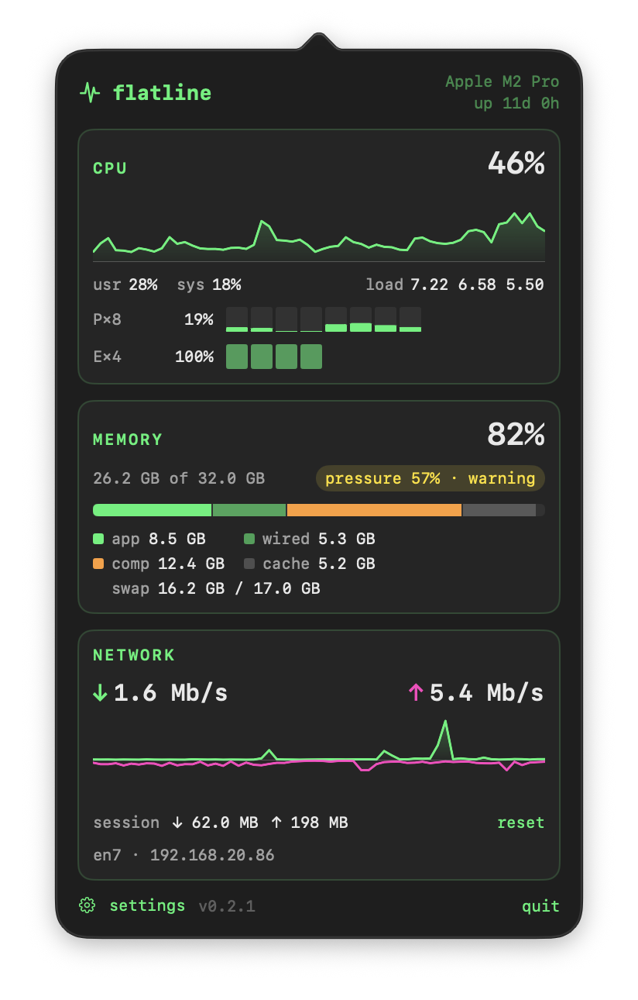

# flatline

A small, fast menu bar monitor for Apple Silicon Macs. It shows **CPU**, **memory**, and **network** and nothing else.

> Keep an eye on the trace. Hope it never goes flat.

<p align="center">
  <picture>
    <source media="(prefers-color-scheme: dark)" srcset="site/screenshots/menubar-dark.png">
    
  </picture>
  <br><br>
  
</p>

flatline is a deliberately narrow alternative to all-in-one monitors like [eul](https://github.com/gao-sun/eul). It drops Intel and older macOS support completely, so it can use what Apple Silicon offers (load per Performance and Efficiency core cluster, memory pressure the way macOS calculates it) while staying almost invisible in Activity Monitor.

**Status:** 0.2.1, heading for 1.0. Signed, notarized and self-updating. See the [PRD](PRD.md).

## Features

- **CPU**: total, user/system, **per-cluster (P / E)** and per-core load, load average
- **Memory**: used / app / wired / compressed / cached with Activity Monitor's definitions, **memory pressure**, swap
- **Network**: live down/up rates using 64-bit counters (no false spikes at 4 GiB), session totals, active interface
- Fixed-width menu bar that doesn't jump around, with `text`, `trace`, or `text+trace` styles
- Popover with 60-second traces and a per-core grid
- Terminal-style monospaced look with a phosphor accent; native light and dark mode
- Launch at login, automatic updates via [Sparkle](https://sparkle-project.org)
- No telemetry, no root helper, no kernel extensions, no SMC access

## Requirements

- macOS 27 or later
- Apple Silicon (M1 or newer)

## Install

Download the latest DMG from **[flatline.banast.as](https://flatline.banast.as)**, open it and drag flatline to Applications. It updates itself after that.

## Building from source

Requires Xcode 27+ and [XcodeGen](https://github.com/yonaskolb/XcodeGen).

```bash
brew install xcodegen
xcodegen generate
open Flatline.xcodeproj
```

Sampler unit tests run without Xcode:

```bash
swift test --package-path Packages/FlatlineKit
```

Debug builds are ad-hoc signed and run on any Mac. Release builds are signed with the maintainer's Developer ID.

## Releasing

1. Add a `## 0.2.0 (date)` section to [CHANGELOG.md](CHANGELOG.md). It becomes the release notes.
2. Run:

   ```bash
   scripts/bump-version.sh 0.2.0   # sets the version, increments the build number
   scripts/release.sh              # test, archive, sign, notarize, staple, add to the update feed
   scripts/deploy-site.sh          # publish flatline.banast.as: page, appcast, DMGs
   ```

3. Commit `site/appcast.xml`, `project.yml` and the changelog.

`release.sh --skip-notarize` makes a signed but un-notarized DMG for a quick check.

One-time setup on the release Mac:

- Notary credentials: `xcrun notarytool store-credentials flatline --team-id F87BNUZAVJ`
- Sparkle's update-signing key, in the login keychain under account `flatline`. Back it up somewhere safe; without it, existing installs can't verify new updates. Export it with `build/SourcePackages/artifacts/sparkle/Sparkle/bin/generate_keys --account flatline -x <file>` and restore it with `-f <file>`.
- Cloudflare: `npx wrangler login`. `releases/` (every shipped DMG) lives only on the release Mac and the live site.

## License

[MIT](LICENSE)
